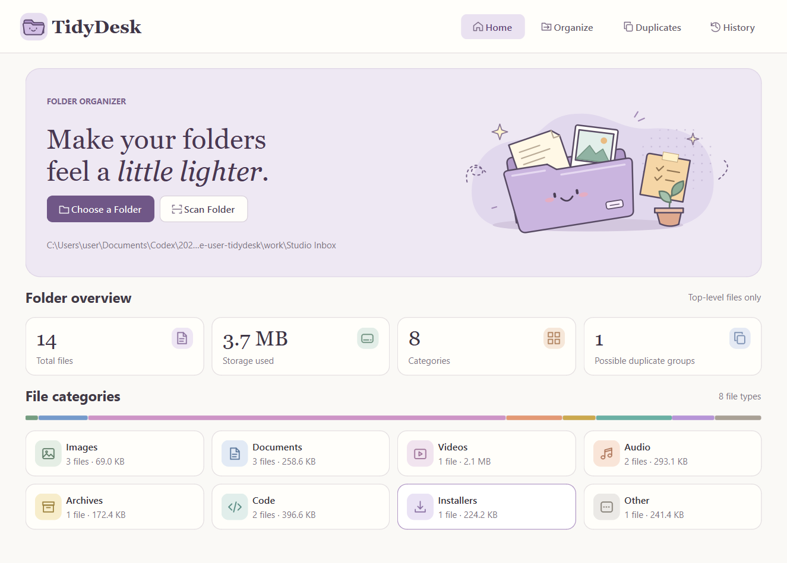

# TidyDesk



I built TidyDesk because my Downloads folder always seems to collect screenshots, installers, and three copies of the same attachment. I wanted to see where everything would go before I let anything move.

I start on **Home**, choose a local folder, and scan its top level. The storage bar shows which file types take up the most room. In **Organize**, I can uncheck individual files and review every destination, including alternate names for conflicts. I confirm the selection before the first move.

I use **Duplicates** to compare matching-size files by SHA-256. Expanding a group lets me inspect each path or open its folder. **History** lets me undo the latest available organization. If a file has changed or its original name is occupied, I can read the reason in the session details.

## Run on Windows

I use Python 3.12, PySide6 for the interface, and SQLite for the per-user journal. From the repository folder, I run these commands in PowerShell.

```powershell
py -3.12 -m venv .venv
.\.venv\Scripts\python.exe -m pip install -r requirements.txt
.\.venv\Scripts\python.exe -m app.main
```

## Build and test

```powershell
.\build.bat
.\.venv\Scripts\python.exe -m pytest -q
```

PyInstaller writes the standalone app to `dist\TidyDesk.exe`. My tests use temporary files to exercise collisions, content checks, undo, and interrupted moves. TidyDesk records each rename intent before acting and checks unfinished records on its next launch. Empty category folders stay in place after undo.

